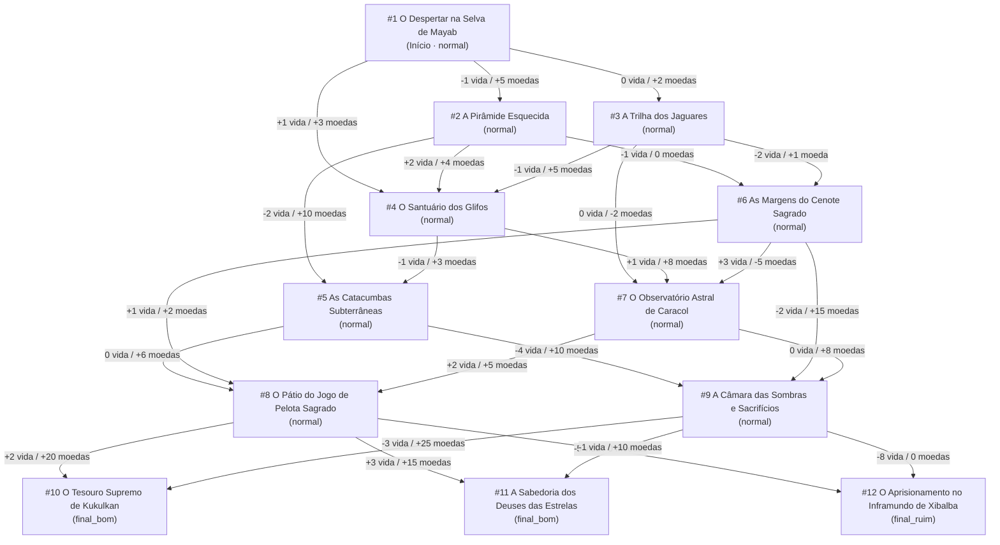

<div align="center">


<p>
  
  
  
  
  
</p>

<p>
  <a href="#sobre-o-projeto">Sobre o Projeto</a> &nbsp;&bull;&nbsp;
  <a href="#arquitetura-e-estrutura-de-pastas">Arquitetura</a> &nbsp;&bull;&nbsp;
  <a href="#fases-cenas-e-fluxo-narrativo">Fases e Cenas</a> &nbsp;&bull;&nbsp;
  <a href="#como-funciona-a-pontuacao-das-fases">Pontuação</a> &nbsp;&bull;&nbsp;
  <a href="#seguranca-e-padroes-tecnicos">Segurança</a> &nbsp;&bull;&nbsp;
  <a href="#identidade-visual-e-design-system">Design System</a> &nbsp;&bull;&nbsp;
  <a href="#instalacao-e-execucao">Instalação</a> &nbsp;&bull;&nbsp;
  <a href="#equipe-e-perfis-de-acesso">Equipe</a>
</p>

</div>

---

## Sobre o Projeto

**MAYAB — O Templo Perdido** é um jogo web de aventura narrativa interativa desenvolvido para o **Projeto Integrador — Fábrica de Jogos (SENAI Félix Guisard · 2026)**, baseado na ficha **07 · Escolha Seu Destino**.

Ambientado em uma representação ficcional de Yucatán, México, o enredo acompanha uma expedição arqueológica em 2026 que encontra uma relíquia capaz de abrir um portal temporal para o passado maia. Do outro lado, o jogador atravessa ruínas, armadilhas, cenotes e câmaras sagradas tomando decisões que alteram diretamente sua **vida**, suas **moedas** e o **desfecho da expedição** ao longo de **72 rotas possíveis**.

<table>
  <tr>
    <td width="50%" valign="top">
      <h3> &nbsp;Narrativa Ramificada</h3>
      <p>12 cenas interconectadas (cenas <code>1</code> a <code>9</code> de progressão e <code>10</code> a <code>12</code> de encerramento) ligadas por 24 escolhas com consequências imediatas em vida e moedas e ilustrações dedicadas.</p>
    </td>
    <td width="50%" valign="top">
      <h3> &nbsp;Motor Server-Side &amp; Anti-Trapaça</h3>
      <p>Toda regra de negócio, validação de escolha na cena atual, cálculo de pontos, proteção CSRF e persistência transacional acontecem exclusivamente no PHP via <code>$_SESSION['partida']</code> e PDO.</p>
    </td>
  </tr>
  <tr>
    <td width="50%" valign="top">
      <h3> &nbsp;Painel Administrativo</h3>
      <p>CRUD completo de cenas e escolhas restrito a usuários com perfil <code>admin</code>, permitindo expandir a árvore narrativa, ilustrações e modificadores de atributos diretamente pela interface web.</p>
    </td>
    <td width="50%" valign="top">
      <h3> &nbsp;Ranking Global e Histórico</h3>
      <p>Classificação geral com as 10 maiores pontuações do servidor (com critérios de desempate por vida, moedas e data) e histórico pessoal das 5 últimas expedições do jogador autenticado.</p>
    </td>
  </tr>
</table>

<div align="center">
  <br/>
  
</div>

---

## Arquitetura e Estrutura de Pastas

O projeto é escrito em **PHP 8 procedural puro** (sem frameworks ou Composer), utilizando **PDO** para acesso ao MySQL/MariaDB e separação clara entre utilitários compartilhados (`includes/`), recursos visuais (`assets/`) e controladores de página na raiz:

```text
projeto-express-interdependente/
├── .antigravityrules/                  # Diretrizes técnicas e especificação do jogo
│   ├── rules.md                        # Stack obrigatória, padrões de segurança e sessão
│   └── game-spec.md                    # Modelagem de tabelas, anti-trapaça e pontuação
├── .env.example                        # Modelo de variáveis de ambiente para conexão MySQL
├── .gitignore                          # Ignora .env, temporários e arquivos de sistema
├── includes/
│   ├── conexao.php                     # Singleton procedural conectar_bd(), sessão, h() e CSRF
│   ├── protege.php                     # Bloqueio de rotas autenticadas, eh_admin() e exige_admin()
│   ├── topo.php                        # Cabeçalho HTML5, fontes/CSS dinâmico e navegação
│   └── rodape.php                      # Fechamento estrutural, rodapé condicional e script JS
├── assets/
│   ├── css/
│   │   ├── base/global.css             # Tokens CSS, reset, tipografia e acessibilidade
│   │   ├── components/components.css   # Cards glassmorphism, botões, badges, HUD e tabelas
│   │   └── pages/
│   │       ├── auth.css                # Layout das telas de login e cadastro
│   │       ├── home.css                # Hero, seções da landing page e cards de personagens
│   │       └── jogo.css                # HUD da partida, cena, escolhas, resultado e ranking
│   ├── img/
│   │   ├── logo.png                    # Logotipo oficial MAYAB
│   │   ├── fundo_hero.jpeg             # Fundo da tela inicial (Hero)
│   │   ├── Explorador.jpeg             # Retrato do perfil Explorador
│   │   ├── Estudante.jpeg              # Retrato do perfil Estudante
│   │   ├── Arqueólogo.jpeg             # Retrato do perfil Arqueólogo
│   │   └── MAYAB_Cenas_02_a_12_4K/     # Ilustrações 4K das cenas 02 a 12
│   └── js/
│       └── script.js                   # Scroll suave, reveal, seleção visual de cards e feedback
├── banco.sql                           # Script DDL/DML (banco mayab, índices, FKs, usuários e cenas)
├── index.php                           # Landing page com história, personagens e acesso ao portal
├── cadastro.php                        # Cadastro com password_hash() e login automático
├── login.php                           # Autenticação via password_verify() e rehash automático
├── logout.php                          # Limpeza de sessão/cookies e redirecionamento
├── jogo.php                            # Motor da partida: cenas, escolhas, vida/moedas e pontuação
├── ranking.php                         # Top 10 global e últimas 5 partidas do jogador
├── admin.php                           # Painel CRUD de cenas e escolhas (restrito a admin)
└── README.md                           # Documentação técnica do projeto
```

> **Nota sobre JavaScript:** Em conformidade com [rules.md](.antigravityrules/rules.md), `assets/js/script.js` é utilizado **exclusivamente para efeitos visuais** (scroll suave, `IntersectionObserver`, seleção visual dos cards de personagens na landing page e aviso do botão Google). **Nenhuma lógica de jogo, controle de vida/moedas ou cálculo de pontos roda no navegador.**

---

## Fases, Cenas e Fluxo Narrativo

A página inicial ([index.php](index.php)) apresenta três perfis temáticos de expedição — **Explorador** (*Travessia & Ação*), **Estudante** (*Glifos & Enigmas*) e **Arqueólogo** (*Relíquias & Liderança*) — para ambientar a narrativa. Ao cruzar o portal em [jogo.php](jogo.php), toda expedição começa obrigatoriamente na **Cena 1** com os mesmos atributos iniciais no servidor.

### Mapa de Progressão das 12 Cenas



### Catálogo das Cenas Iniciais (`banco.sql`)

| ID | Título da Cena | Tipo | Escolhas | Destinos Possíveis |
| :---: | :--- | :---: | :---: | :--- |
| **1** | O Despertar na Selva de Mayab | `normal` | 3 | `#2`, `#3`, `#4` |
| **2** | A Pirâmide Esquecida | `normal` | 3 | `#5`, `#4`, `#6` |
| **3** | A Trilha dos Jaguares | `normal` | 3 | `#6`, `#4`, `#7` |
| **4** | O Santuário dos Glifos | `normal` | 2 | `#7`, `#5` |
| **5** | As Catacumbas Subterrâneas | `normal` | 2 | `#8`, `#9` |
| **6** | As Margens do Cenote Sagrado | `normal` | 3 | `#9`, `#8`, `#7` |
| **7** | O Observatório Astral de Caracol | `normal` | 2 | `#8`, `#9` |
| **8** | O Pátio do Jogo de Pelota Sagrado | `normal` | 3 | `#10`, `#11`, `#12` |
| **9** | A Câmara das Sombras e Sacrifícios | `normal` | 3 | `#11`, `#10`, `#12` |
| **10** | O Tesouro Supremo de Kukulkan | `final_bom` | — | Desfecho vitorioso (tesouro) |
| **11** | A Sabedoria dos Deuses das Estrelas | `final_bom` | — | Desfecho vitorioso (conhecimento) |
| **12** | O Aprisionamento no Inframundo de Xibalba | `final_ruim` | — | Desfecho trágico (derrota) |

---

## Como Funciona a Pontuação das Fases

Toda partida em [jogo.php](jogo.php) é controlada por constantes e regras no servidor, garantindo equilíbrio entre risco, coleta de moedas e preservação de vida.

### 1. Atributos e Limites Durante a Expedição

| Parâmetro | Valor / Regra | Implementação em `jogo.php` |
| :--- | :--- | :--- |
| **Cena Inicial** | `#1` (*O Despertar na Selva de Mayab*) | `CENA_INICIAL_ID = 1` |
| **Vida Inicial** | `10` pontos | `VIDA_INICIAL = 10` |
| **Vida Mínima / Máxima** | Mínimo `0` (derrota) · Teto `20` | `max(0, min(VIDA_MAX, $vidaAnterior + $efeitoVida))` |
| **Moedas Iniciais** | `0` moedas | `MOEDAS_INICIAIS = 0` |
| **Piso de Moedas** | Nunca fica negativa (mínimo `0`) | `max(0, $moedasAnterior + $efeitoMoedas)` |
| **Contador de Turnos** | Incrementado em `+1` a cada decisão válida | `$passos + 1` armazenado em `$_SESSION['partida']` |

> **Observação sobre moedas negativas:** Caso o jogador tenha `0` moedas e faça uma escolha com `efeito_moedas = -2` ou `-5` (como acender tocha na Cena 3 ou fazer oferenda na Cena 6), o saldo é limitado em `0` — portanto, o jogador não acumula dívida de moedas.

### 2. Fluxo de Turno e Condição de Encerramento

1. **Inicialização (`acao = iniciar`):** Cria `$_SESSION['partida']` vinculada ao `usuario_id` logado, definindo `cena_id = 1`, `vida = 10`, `moedas = 0`, `finalizada = false` e `salva_bd = false`.
2. **Validação Anti-Trapaça (`acao = escolher`):** Ao enviar `escolha_id`, o servidor verifica o token CSRF e executa em banco:
   ```sql
   SELECT e.id, e.cena_id, e.texto, e.destino_id, e.efeito_vida, e.efeito_moedas,
          c.tipo AS destino_tipo
   FROM escolhas e
   INNER JOIN cenas c ON c.id = e.destino_id
   WHERE e.id = :escolha_id AND e.cena_id = :cena_id
   LIMIT 1
   ```
   Qualquer `escolha_id` adulterada ou pertencente a outra cena é rejeitada.
3. **Condição de Fim:** A partida encerra imediatamente quando ocorre **pelo menos uma** das situações:
   * **Vida esgotada (`vida <= 0`):** gera `motivo_fim = 'derrota_vida'`.
   * **Cena final atingida (`destino_tipo !== 'normal'`):** gera `motivo_fim = 'final_bom'` ou `'final_ruim'`.
4. **Persistência Única (Anti-F5):** Dentro de uma transação SQL (`beginTransaction()` / `commit()`), se `$finalizada && !$salvaBd`, o resultado é gravado uma única vez na tabela `partidas` e o script redireciona com **Post/Redirect/Get (PRG)** para `jogo.php`. Atualizar a página com `F5` apenas reexibe o resultado da sessão sem duplicar registros.

### 3. Fórmula de Cálculo da Pontuação

Ao finalizar a expedição, a função `calcular_pontuacao_final()` calcula os pontos no servidor conforme o desfecho:

| Desfecho | Condição Exata no PHP | Fórmula | Peso por Recurso |
| :--- | :--- | :--- | :--- |
| **Vitória (`Final Bom`)** | `$tipoCena === 'final_bom' && $vida > 0` | `500 + ($moedas * 10) + ($vida * 20)` | **500** bônus base + **10 pts/moeda** + **20 pts/vida restante** |
| **Derrota (`Final Ruim` ou Vida Zerada)** | `$tipoCena === 'final_ruim' \|\| $vida <= 0` | `max(0, $moedas * 5)` | **0** bônus base + **5 pts/moeda** (sem bônus de vida) |

> **Atenção ao risco de zerar a vida na última escolha:** Mesmo que a escolha aponte para uma cena `final_bom` (como a Cena 10), se o `efeito_vida` reduzir sua vida para `0`, a condição `$vida > 0` falha! Nesse caso, a partida termina como derrota por vida esgotada (`derrota_vida`) e aplica-se a fórmula reduzida (`moedas × 5`), perdendo os `500` pontos de vitória.

### 4. Exemplos Reais de Rotas e Pontuações

Os cenários abaixo foram calculados diretamente sobre os valores atuais de [banco.sql](banco.sql):

| Estratégia / Cenário | Rota Percorrida | Vida Final | Moedas Finais | Tipo Final | Cálculo Aplicado | Pontuação |
| :--- | :--- | :---: | :---: | :---: | :--- | :---: |
| **Rota Perfeita (Máxima)** | `#1 → #2 → #4 → #7 → #8 → #10` | `16` | `42` | `final_bom` | `500 + (42 × 10) + (16 × 20)` | **1.240 pts** |
| **Rota Segura (Final Alternativo)** | `#1 → #3 → #4 → #5 → #9 → #11` | `3` | `30` | `final_bom` | `500 + (30 × 10) + (3 × 20)` | **860 pts** |
| **Ganância Fatal (Morre na Cena 10)** | `#1 → #2 → #5 → #9 → #10` | `0` | `50` | `derrota_vida` | `50 × 5` *(vida zerou no `-3` final)* | **250 pts** |
| **Pior Desfecho (Inframundo)** | `#1 → #3 → #6 → #8 → #12` | `4` | `5` | `final_ruim` | `5 × 5` | **25 pts** |

<details>
<summary><strong>Ver passo a passo da Rota Perfeita (1.240 pontos)</strong></summary>

1. **Início (Cena `#1`):** `10` vida · `0` moedas.
2. **`#1 → #2`** (*Subir as escadarias da pirâmide* | `-1` vida, `+5` moedas): `9` vida · `5` moedas.
3. **`#2 → #4`** (*Decifrar os relevos do altar solar* | `+2` vida, `+4` moedas): `11` vida · `9` moedas.
4. **`#4 → #7`** (*Consultar o mapa astronômico* | `+1` vida, `+8` moedas): `12` vida · `17` moedas.
5. **`#7 → #8`** (*Alinhar as lentes com o sol nascente* | `+2` vida, `+5` moedas): `14` vida · `22` moedas.
6. **`#8 → #10`** (*Arremessar a bola pelo aro sagrado* | `+2` vida, `+20` moedas): **`16` vida · `42` moedas**.
7. **Pontuação final:** `500 + 420 + 320 = 1.240 pts`.

</details>

### 5. Regras de Classificação no Ranking (`ranking.php`)

* **Top 10 Global:** ordena as partidas registradas seguindo a prioridade:
  1. Maior **pontuação** (`pontos DESC`)
  2. Maior **vida final** (`vida_final DESC`)
  3. Maior quantidade de **moedas finais** (`moedas_final DESC`)
  4. **Data mais antiga** (`jogada_em ASC`) — em empate absoluto, quem atingiu a marca primeiro permanece na frente.
* **Histórico Pessoal:** exibe as **5 partidas mais recentes** do jogador autenticado (`jogada_em DESC, id DESC`).

---

## Segurança e Padrões Técnicos

* **Conexão PDO isolada e estática (`includes/conexao.php`):** `conectar_bd(): PDO` usa `static $pdo` (padrão singleton em procedural), `ATTR_EMULATE_PREPARES => false`, `ATTR_ERRMODE => PDO::ERRMODE_EXCEPTION` e lê credenciais com prioridade `.env` → variáveis de ambiente → padrões locais do XAMPP (`127.0.0.1:3306`), registrando erros via `error_log()` sem expor detalhes do banco ao navegador.
* **Consultas Parametrizadas:** 100% das queries utilizam `prepare()` / `execute()` com **placeholders nomeados** (`:id`, `:email`, `:cena_id`, etc.) e seleção explícita de colunas.
* **Proteção contra CSRF, XSS e Path Traversal:**
  * Token CSRF gerado com `random_bytes(32)` e validado em tempo constante via `hash_equals()` (`csrf_token()` / `verificar_csrf()`).
  * Todas as saídas HTML dinâmicas passam por `h()` (`htmlspecialchars(..., ENT_QUOTES | ENT_SUBSTITUTE, 'UTF-8')`).
  * `resolver_imagem_cena()` bloqueia `..`, URLs externas e valida a existência do arquivo em disco antes de exibir imagens de cenas.
* **Autenticação e Sessão Segura:**
  * Senhas armazenadas com `password_hash(..., PASSWORD_DEFAULT)`, validadas com `password_verify()` e atualizadas automaticamente quando necessário com `password_needs_rehash()`.
  * Cookies de sessão configurados com `cookie_httponly`, `cookie_samesite => 'Lax'`, `use_strict_mode => true` e `session_regenerate_id(true)` no login e após o cadastro.
  * Controle de acesso centralizado em `includes/protege.php` (`eh_admin()` e `exige_admin()`).

---

## Identidade Visual e Design System

A interface combina tons de pedra vulcânica, dourado maia, verde selva e turquesa com cards em *glassmorphism*, seguindo contraste acessível e suporte a `prefers-reduced-motion`.

### Paleta Cromática (`assets/css/base/global.css`)

| Token CSS | Amostra | Nome | HEX | Aplicação na Interface |
| :--- | :---: | :--- | :--- | :--- |
| `--bg` |  | **Preto Profundo** | `#121212` | Fundo principal e texto em botões dourados |
| `--bg-deep` |  | **Obsidiana** | `#0b0e0c` | Fundo das páginas de autenticação, HUD e rodapé |
| `--surface` |  | **Verde Selva** | `#1A4D34` | Superfícies de cards e efeitos translúcidos |
| `--surface-dark` |  | **Selva Noturna** | `#102a1d` | Painéis administrativos e fundo de ilustrações |
| `--gold` |  | **Dourado Maia** | `#D49934` | Títulos, botões primários (hover `#E8B65B`) e moedas |
| `--bronze` |  | **Bronze Antigo** | `#8B621B` | Ornamentos e detalhes decorativos |
| `--jade` |  | **Verde-Jade** | `#3DA66B` | Indicadores de vida, sucesso e final bom |
| `--sand` |  | **Areia Antiga** | `#B5A577` | Bordas funcionais, turnos e contorno de foco |
| `--turquoise` |  | **Turquesa** | `#248799` | Elementos do portal temporal e badges |
| `--text` |  | **Texto Claro** | `#F4EBD8` | Tipografia principal (secundário `--text-muted: #CFC3AB`) |
| `--error` |  | **Alerta de Erro** | `#F08B80` | Mensagens de validação, derrota e perda de recursos |

### Tipografia

* **Títulos (`--font-title`):** `Cinzel` (fallback `Georgia, serif`), peso `700`.
* **Corpo e Controles (`--font-body`):** `Montserrat` (fallback `system-ui, sans-serif`), `1rem` com entrelinha `1.7`.

---

## Instalação e Execução

### Pré-requisitos
* **XAMPP** (Apache + MySQL/MariaDB + phpMyAdmin) com **PHP 8.0 ou superior** (extensões `pdo_mysql` e `mbstring` habilitadas).

### Passo a Passo

1. **Inicie os serviços:** Abra o painel de controle do **XAMPP** e ative os módulos **Apache** e **MySQL**.
2. **Posicione os arquivos:** Copie ou clone o repositório na pasta pública do Apache:
   ```text
   C:\xampp\htdocs\mayab
   ```
3. **Importe o banco de dados:**
   * Acesse `http://localhost/phpmyadmin`.
   * Abra a aba **Importar** (ou **SQL**), selecione o arquivo `banco.sql` na raiz do projeto e execute.
   * O script criará o banco `mayab` (`utf8mb4`), as tabelas `usuarios`, `cenas`, `escolhas` e `partidas` (com índices de ranking e chaves estrangeiras `ON DELETE CASCADE`), os 2 usuários iniciais, as 12 cenas e as 24 escolhas.
4. **(Opcional) Configure variáveis de ambiente:**
   * Caso utilize porta, usuário ou senha diferentes do padrão XAMPP (`127.0.0.1`, `3306`, `root`, senha vazia), copie `.env.example` para `.env` na raiz e preencha os valores.
5. **Acesse no navegador:**
   ```text
   http://localhost/mayab
   ```

<details>
<summary><strong>Ver Modelagem Relacional do Banco de Dados (<code>mayab</code>)</strong></summary>

* **`usuarios`:** `id`, `nome`, `apelido` (`UNIQUE`), `email` (`UNIQUE`), `senha` (`password_hash`), `perfil` (`ENUM('admin', 'jogador')`).
* **`cenas`:** `id`, `titulo`, `texto`, `imagem`, `tipo` (`ENUM('normal', 'final_bom', 'final_ruim')`).
* **`escolhas`:** `id`, `cena_id` (FK `cenas.id ON DELETE CASCADE`), `texto`, `destino_id` (FK `cenas.id ON DELETE CASCADE`), `efeito_vida`, `efeito_moedas`.
* **`partidas`:** `id`, `usuario_id` (FK `usuarios.id ON DELETE CASCADE`), `cena_final_id` (FK `cenas.id ON DELETE CASCADE`), `vida_final`, `moedas_final`, `pontos`, `jogada_em`, com índices `idx_partidas_ranking` e `idx_partidas_usuario_data`.

</details>

---

## Equipe e Perfis de Acesso

### Usuários de Teste (`banco.sql`)

| Perfil | E-mail | Senha | Permissões |
| :--- | :--- | :--- | :--- |
| **Administrador** | `admin@jogo.com` | `admin123` | Acesso ao jogo, ranking e painel `admin.php` (CRUD completo de cenas e escolhas) |
| **Jogador** | `jogador@jogo.com` | `jogador123` | Acesso ao jogo (`index.php`, `jogo.php`) e visualização de `ranking.php` |

### Integrantes do Projeto

| Integrante | Turma | Frente de Atuação |
| :--- | :--- | :--- |
| **Rafael de Oliveira Pereira** | DS B| Arquitetura do banco (`banco.sql`), autenticação, segurança e painel administrativo |
| **Isabela Paiva** | DS a | Requisitos, modelagem de dados e testes de acesso/administração |
| **Macedo** | DS B | Motor do jogo (`jogo.php`), cálculo de pontuação, ranking e integração visual |
| **Luana** | DS B | Estilização CSS, responsividade, captura de telas e testes funcionais |
| **Nathaly Marrote** | Multimídia | Identidade visual, manual de marca, logotipo e ilustrações das cenas |
| **Andressa** | Multimídia | Tipografia, direção de arte, roteiro e edição do vídeo pitch (30s) |

<div align="center">
  <br/>
  
</div>
